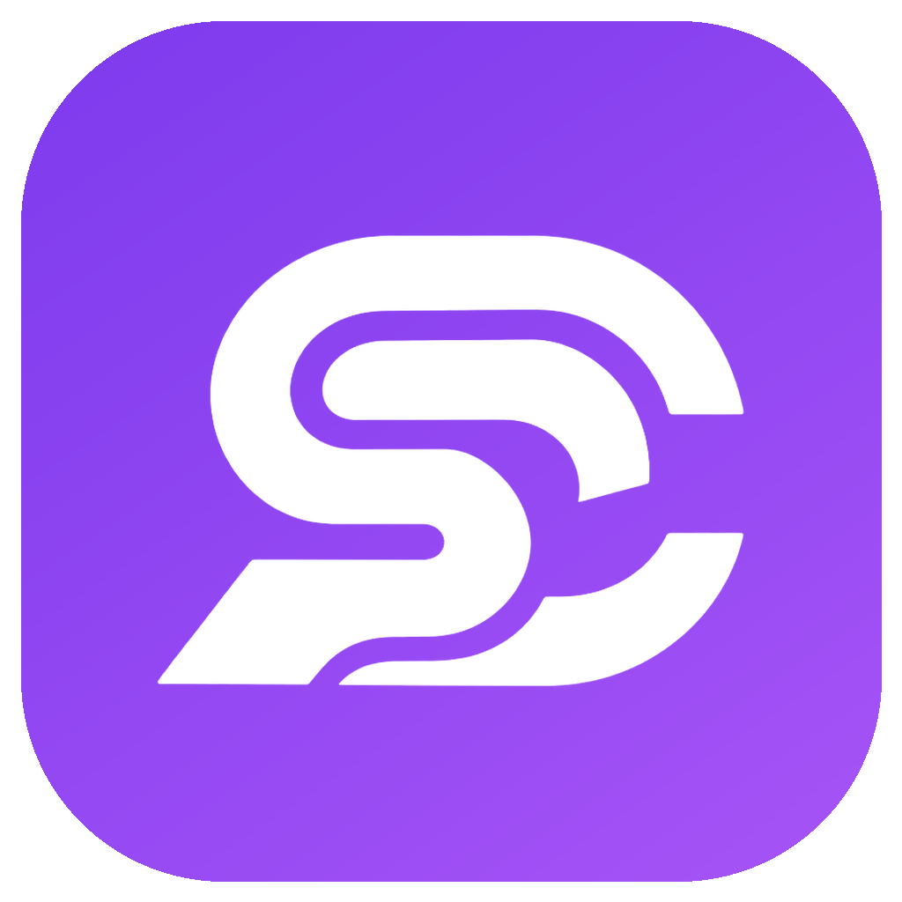

<h1 align="center">ShortsClaw</h1>

<b>Free gameplay highlight clipper.</b> Drop in a recording and get vertical clips with captions, ready for Shorts, TikTok and Reels.

<a href="https://github.com/shortsclaw/ShortsClaw/releases/latest/download/ShortsClaw-windows-x64.zip"><b>⬇ Download for Windows</b></a> · <a href="https://shortsclaw.github.io">Website</a>

## What it does

- **Finds the best moments:** scores loudness and on-screen action, and shows why each clip was picked
- **Chat highlights:** paste a YouTube stream link and the moments where chat exploded become clips
- **Auto captions:** word-by-word subtitles, with the spoken word in yellow (offline, whisper.cpp)
- **Facecam layout:** your cam on top, gameplay below, 1080×1920
- **Hook text, watermark and logo**, plus **swear-word bleep**
- **Titles and hashtags** written for every clip
- **GPU export** on NVIDIA, AMD and Intel, with CPU fallback

Free forever. No account, no watermark, no upload: everything runs on your PC.

## Install

1. Download `ShortsClaw-windows-x64.zip` from [Releases](https://github.com/shortsclaw/ShortsClaw/releases/latest).
2. Unzip it anywhere and run `ShortsClaw.exe`.
3. If Windows says "Windows protected your PC", click **More info → Run anyway** (the app isn't code-signed yet).

Requires Windows 10/11, 64-bit.

## Credits

ShortsClaw bundles [FFmpeg](https://ffmpeg.org) (GPL), [whisper.cpp](https://github.com/ggml-org/whisper.cpp) (MIT) and [yt-dlp](https://github.com/yt-dlp/yt-dlp) (Unlicense).
Only clip streams you own or have permission to use. ShortsClaw is not affiliated with Rockstar Games, Take-Two or any game publisher.
